<div align="center">
  

  <p><strong>From a live-action script to clean authority assets, spatially coherent sequences, executable camera plans, and a portable Higgsfield-ready production package.</strong></p>

  <p>
    <a href="README.zh-CN.md">简体中文</a> ·
    <a href="https://hughhhhcoder.github.io/cinematic-ai-director/">Documentation</a> ·
    <a href="https://github.com/Hughhhhcoder/cinematic-ai-director/releases/latest">Latest release</a>
  </p>

  <p>
    <a href="https://github.com/Hughhhhcoder/cinematic-ai-director/actions/workflows/ci.yml"></a>
    <a href="https://github.com/Hughhhhcoder/cinematic-ai-director/actions/workflows/docs.yml"></a>
    <a href="https://github.com/Hughhhhcoder/cinematic-ai-director/releases/latest"></a>
    <a href="LICENSE"></a>
    
    
    
  </p>
</div>


## Why this exists

Many AI-film workflows optimize for an attractive first frame. Production needs something harder: the same person with the correct body, the same place from executable camera positions, states that change only when the story changes, light and weather with physical consequences, and prompts that remain aligned with the underlying facts.

`cinematic-ai-director` is an English-first Codex Skill and dependency-free Python toolkit for live-action films, commercials, and music videos. It treats generation as an auditable production system:

- unsuccessful images may occur backstage, but they never enter authority manifests, approval boards, or exports;
- identity, role-conditioned physique, location topology, props, atmosphere, cinematography, and time are separate state responsibilities;
- user interruption is reduced to one Foundation gate and one gate per sequence;
- the final result is a portable, offline package a human can execute in Higgsfield without this Skill signing in or consuming credits.

> This is an independent open-source project. It is not affiliated with or endorsed by Higgsfield or OpenAI.

## What v1.6 controls

| System | Production behavior |
|---|---|
| Live-action quality | Positive photographic evidence, motivated skin highlights, independent material roughness, four-scale smear/CG/texture inspection |
| Person–world proof | Mandatory ordinary-light locked-location insertion with one exposure, light field, focus system, finite dynamic range and verified set correspondence before any styled human frame |
| Casting and physique | Role-conditioned body brief, measurable targets, wardrobe silhouette, rejection criteria, no generic short-legged or boxy fallback |
| Identity geometry | One 4×2 white identity inspector per person, one shared identity solve, seven deterministic crops, person-specific proportions, skeleton lock, and multi-person projection QA |
| World continuity | Location worlds and states, production-design DNA, prop manufacturing/state locks, return-to-location reuse |
| Spatial execution | Establishing plus side-three-quarter views, one fixed scene anchor, set coordinates, camera/subject marks, off-screen direction and distance |
| Cinematography | Script-derived treatment, observer identity, format gate, motivated light, finite scene-referred dynamic range, exposure/focus behavior, polish ceiling |
| Environment | Causal rain, snow, fog/smoke, dust/wind, fire/light events, underwater and heat behavior with temporal bounds |
| Movement and time | Reconstructable support/path, clearance, parallax, capture/delivery fps, shutter exposure, speed map, directional motion blur |
| Low-interruption review | Independent candidate pools, hidden failures, atomic Foundation/sequence decisions, dependency-scoped rework |
| Higgsfield delivery | Strict, dated Cinema Studio 4 + Seedance 2.5 conformance; official prompt order, deterministic `@handle` references, checksums and offline verification |

## The complete workflow

```mermaid
flowchart LR
    A[Script reality analysis] --> B[Casting + role physique]
    B --> C[One 4×2 identity inspector]
    A --> D[World DNA + location roots]
    D --> E[Multi-view state + spatial anchor]
    C --> F[Character states]
    E --> G[Locked-location ordinary-light person insertion]
    F --> G
    G --> H{Probe passes four-scale QA?}
    H -->|yes| I[Quality profile + format + three Looks]
    H -->|two batches fail| X[backend_realism_blocked]
    I --> J{Foundation gate}
    J --> K[Sequence visual anchor]
    K --> L[Photoboards + keyframes]
    L --> M[Camera path + temporal + blur]
    M --> N{Sequence gate}
    N --> O[Compiled shot prompts]
    O --> P[Portable Higgsfield package]
    P --> Q[Human platform execution]
    Q --> R[Returned-take temporal audit]
```



The authority chain is strict: a failed or unapproved root cannot silently become a storyboard reference, and a bridge frame cannot replace identity or location truth.

## Evidence, not “cinematic” adjectives

The ImageGen strategy does not rely on `8K`, `pores`, `gritty`, `film grain`, `hero lighting`, `dramatic rim light`, or `premium cinematic`. These shortcuts often spread a single synthetic surface across skin, cloth, walls, metal, and glass.

Every compiled image prompt instead contains six compact sections:

1. photographic event;
2. approved identity, world, and state facts;
3. physical camera and blocking;
4. source light and independent material response;
5. focus, exposure, and permitted capture contingency;
6. no more than four concentrated exclusions.

Every selected production image must pass thumbnail, fit, 100%, and 200% inspection. The gate requires visible positive evidence—not merely the absence of an obvious defect.

Real capture latitude is finite. Every generated photograph and Ready shot therefore declares a working latitude, estimated scene contrast, middle-tone anchor, exposure priority, highlight behavior, shadow floor, and any allowed clipping or shadow loss. If scene contrast exceeds the working range, at least one end must lose information. Local tone mapping and multi-exposure HDR merging are forbidden from making every bright and dark region equally explicit.

## Identity and body design

Each recurring person has exactly one first identity authority: a single pure-white `4×2` inspector generated in one ImageGen call so every angle shares the same identity solve. Its fixed cells are:

`full_front · full_left_profile · full_right_profile · full_back`  
`portrait_front · portrait_left_profile · portrait_right_profile · blank`

The whole inspector is validated before anything is cropped. Any identity, anatomy, proportion, skin, hair, garment, lighting, smear, CG, or repeated-texture failure blocks that person immediately; no failed cell may propagate downstream. Seven exact PNG views are then cropped without resampling or repainting for inspection and UI upload convenience. The cropper records an unambiguous central white gutter instead of assuming a mathematically equal row split, so a slightly taller full-body row cannot cut the shoes; a missing/ambiguous gutter or content crossing it fails loudly. Those crops never replace the inspector as ground truth. Front/back establish a person-specific normalized proportion signature; profiles verify body volume and facial topology. A separate role-physique brief explains why the body should read as ordinary, lean, athletic, muscular, fashion-model, dancer, strength/power, endurance-trained, story-specific deconditioned, or a controlled transition.

“Good proportions” are converted into measurable ranges and silhouette requirements. The system rejects lens-distorted long legs, collapsed pelvis/spine, lost shoulder-waist-hip relationships, melted garments, or wardrobe that changes an approved body into another physique.

For fictional adult leads, the default visual leg/body target is a natural `4:6` balance; fashion, dance, action, or performance roles may use a justified `3:7` impression. An unintended `5:5` silhouette is rejected at the identity, wardrobe-state, and narrative-frame gates. These targets are measured with a level camera and normal perspective—never manufactured with a low angle, wide lens, tiny head, or stretched shins.

When two or more people share a frame, the Skill keeps every Inspector's approved height and geometry, then checks them through one camera projection. It records camera height/pitch, subject marks and distances, expected versus observed projected-height relationships, crop-aware body landmarks, horizon/vanishing lines, occlusion order, and a shared ground surface or explicit elevation offset. Per-person scaling, locally inconsistent perspective, floating feet, and hiding an error with crop, defocus, or motion blur are hard failures.

## Location and spatial continuity

Every scene state requires an empty establishing view and an independently generated side-three-quarter wide from a reachable position. They share one approved, stable primary object as `(0,0,0)` and preserve topology, fixed facilities, scale, material baselines, anchor grounding, and light direction.

Ready shots must include:

- a spatial-map ID and reachable camera mark;
- one subject mark for every cast member;
- set-fixed position and facing, not only screen left/right;
- camera-to-anchor and subject-to-anchor distances;
- foreground/midground/background order;
- visible, partial, or off-screen anchor projection with direction and distance;
- start/end marks for movement.

## Cinematography, atmosphere, and motion

The Skill translates genre or film references into original, observable behavior: narrative distance, camera witness, composition order, optical/spatial behavior, motivated sources, display pipeline, support inertia, temporal rhythm, atmospheric medium, polish ceiling, and a return rule.

Format is approved before Look Tests. `16:9` is the default; `1.33`, `1.37`, `1.66`, `1.85`, `2.00`, `2.39`, and `9:16` require a story reason. Black bars are never generated into the image.

Rain, snow, fog, smoke, dust, lightning, fire, projection, underwater light, and heat shimmer must change visibility, accumulation, skin/hair/clothes, materials, exposure, reflection, focus, sound, and time continuity. Atmosphere is never a decorative overlay.

Motion blur is derived from capture fps, delivery fps, shutter angle, camera path, and subject speed. For example, `24 fps / 180°` records roughly `1/48 s` exposure per frame. The shot stores blur source, direction, amount, affected regions, stable reference areas, occlusion-edge behavior, and prohibited artifacts.

Dynamic range is planned with the same physical discipline. The system does not ask ImageGen or Higgsfield for “maximum detail in highlights and shadows.” It chooses what the exposure protects—often skin, a practical source, or a story object—and records what may approach clipping or fall below the texture floor. These facts are stored in `dynamic-range.json` and compressed into the official `LIGHTING` section without inventing a non-official prompt heading.

## Install

### Install as a Codex Skill

```bash
git clone https://github.com/Hughhhhcoder/cinematic-ai-director.git
cd cinematic-ai-director
python3 scripts/install_skill.py install
```

An existing installation is never overwritten silently:

```bash
python3 scripts/install_skill.py install --replace
python3 scripts/install_skill.py verify
```

`--replace` creates a timestamped backup and rolls back if installation fails. `CODEX_HOME` is respected; otherwise the installer uses `~/.codex`.

### Optional Python command

```bash
python3 -m pip install .
cinematic-ai-director --help
```

The runtime supports Python 3.10+ and has no third-party dependencies.

## Quick start

```bash
python3 scripts/film_project.py init \
  --title "Night Shift" \
  --slug night-shift \
  --root ./ai-film

python3 scripts/film_project.py validate ./ai-film/night-shift
```

Then use `$cinematic-ai-director` in Codex with the script or story. The Skill builds facts and ImageGen candidates, presents only the Foundation/sequence boards that require creative decisions, and compiles prompts from approved state.

### Public CLI

```text
init                    Create schema v1.6 without overwriting
validate                Audit files, states, dependencies, QA, prompts and continuity
build-reference-board   Crop seven exact views from one approved 4×2 inspector without repainting
compile-prompts         Compile versioned ImageGen and shot prompts from facts
build-review-board      Build overview and face/hand/material/highlight/shadow diagnostics
record-review           Atomically record a Foundation or sequence decision
export-higgsfield       Create a deterministic, portable, manually executable package
```

See the [getting-started guide](https://hughhhhcoder.github.io/cinematic-ai-director/getting-started/) and the validated [`examples/night-shift`](examples/night-shift/) fixture.

## Higgsfield boundary

The exporter creates upload order, reference roles, `@handles`, exact state locks, spatial maps, quality profile, format plan, camera path, environment state, temporal lock, shot settings, prompts, runbooks, checksums, and offline verification scripts.

Successful v1.6 export means strict structural conformance to the dated official profile `cinema-studio-4-seedance-2.5-official-2026-08-27`: Cinema Studio 4 + Seedance 2.5, the official prompt sequence `GLOBAL STYLE → SCENE → CHARACTERS → LOCATION → FIRST FRAME AND BLOCKING → Shot n → OPTICS → CAMERA → PHYSICS → LIGHTING → AUDIO`, deliberate reference roles, numbered shots and `Hard cut` boundaries, up to 30 seconds, native output up to 1080p, up to 50 references, 9:16–21:9, and native audio. If the current interface differs from that snapshot, export is blocked until the adapter and tests are updated.

It does **not** install a plugin, authenticate, upload references, call a generation endpoint, spend credits, or claim that a stochastic platform render will pass visual QA. The guarantee is the versioned package contract and blocker—not a dishonest guarantee about pixels controlled by a third-party model. See the [official Seedance guide](https://higgsfield.ai/blog/seedance-2-5-prompting-guide), [official short-film reference workflow](https://higgsfield.ai/blog/ai-short-film-youtube-guide), [official movement workflow](https://higgsfield.ai/blog/realistic-ai-human-movement), and [Cinema Studio 4](https://higgsfield.ai/blog/cinema-studio-4-0).

## Showcase

The compact public v1.6.5 gallery contains exactly one clean evidence chain generated with built-in ImageGen: one unified identity authority → one measurable empty world authority → one locked-location person insertion. The probe is deliberately free of dramatic weather, hero lighting, film emulation and stylized grading. The approved empty location is the first reference and immutable edit target; the Inspector is second and supplies identity only. Three candidates independently edited that same plate. A candidate can pass only when the person shares exposure, source light, focus, grounding and finite dynamic range without oily skin or synthetic texture—and the workbench, supports, windows, door, cabinet, red anchor, camera and crop remain corresponding outside the bounded person/contact regions.

| One shared-solve identity Inspector | One empty location | One person-in-location frame |
|---|---|---|
|  |  |  |

This is intentionally a small release proof, not a fabricated statistical pass-rate claim. Exact retained prompts, source-generation IDs, original and derivative SHA-256 values, deterministic identity crops, edit-target-first reference order, three-candidate selection record, normalized set landmarks, outside-edit-region pixel statistics, four-scale QA, finite-dynamic-range review and person–world integration QA are in [`showcase/evidence.json`](showcase/evidence.json) and the [gallery documentation](https://hughhhhcoder.github.io/cinematic-ai-director/gallery/). Failed candidates are removed from the public tree.

## Repository layout

```text
SKILL.md                  Codex routing and production contract
agents/openai.yaml        UI metadata and automatic invocation
references/               On-demand research, schemas, QA and workflow guidance
src/cinematic_ai_director Modular dependency-free runtime
scripts/                  Compatibility CLI, installer and release builder
tests/                    Behavioral, distribution and portability regression tests
examples/night-shift/     Validated structural project and Higgsfield export
docs/                     English-first Pages site plus Chinese core mirror
showcase/                 Approved original evidence and machine-readable provenance
```

## Reproducibility and limitations

- `pixel_reproducible` is always `false`; built-in ImageGen does not expose a stable seed or immutable public snapshot.
- Reproducible: schema, structured facts, prompt compilation, reference order, SHA-256, candidate isolation, approvals, validation, review-board layout, and exports.
- Cross-generation identity and composition can still fail. Stability means failed candidates are blocked—not that every first raw generation succeeds.
- Visual QA is an explicit Codex/human review record, not a fabricated automated aesthetic score.
- Schema v1.0–v1.5 is reported as legacy and is never silently migrated.

## Contributing and security

Read [CONTRIBUTING.md](CONTRIBUTING.md), the [Code of Conduct](CODE_OF_CONDUCT.md), and [SECURITY.md](SECURITY.md). Do not submit non-consensual identities, copied project prompts/media, credentials, sessions, or images that failed the live-action gate.

## License

Apache-2.0. Copyright 2026 Hughhhhcoder. See [LICENSE](LICENSE), [NOTICE](NOTICE), and [THIRD_PARTY_NOTICES.md](THIRD_PARTY_NOTICES.md).
