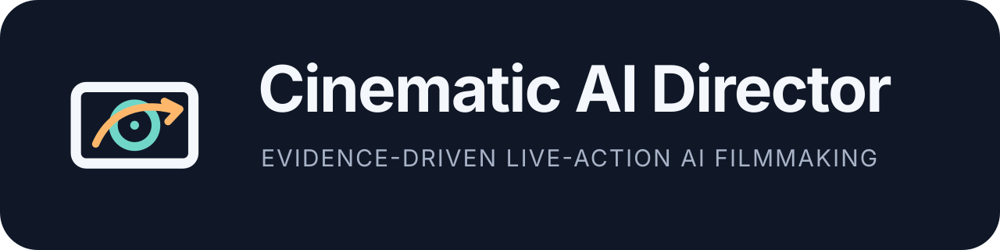
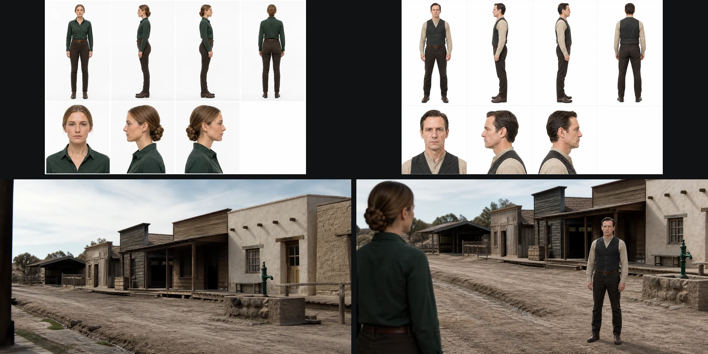
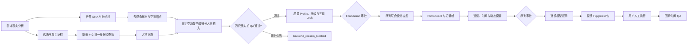
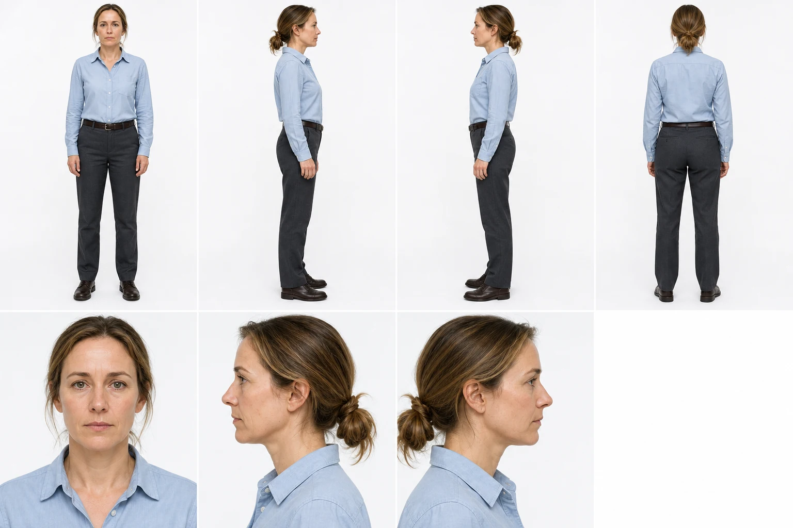
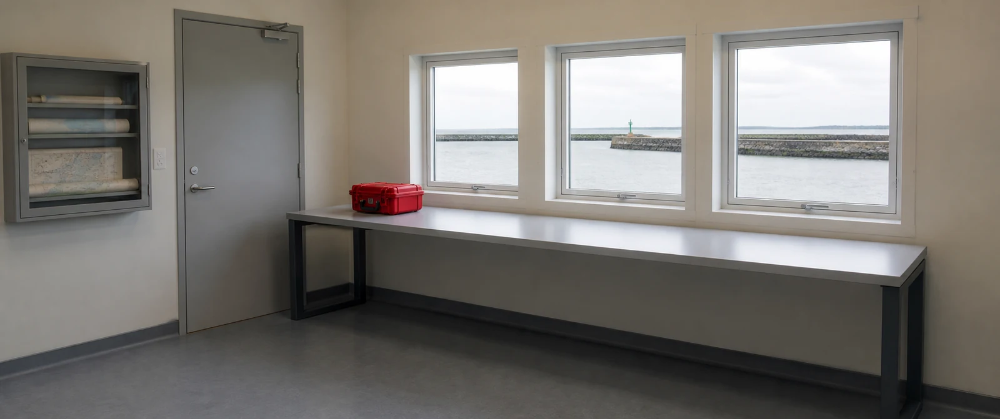
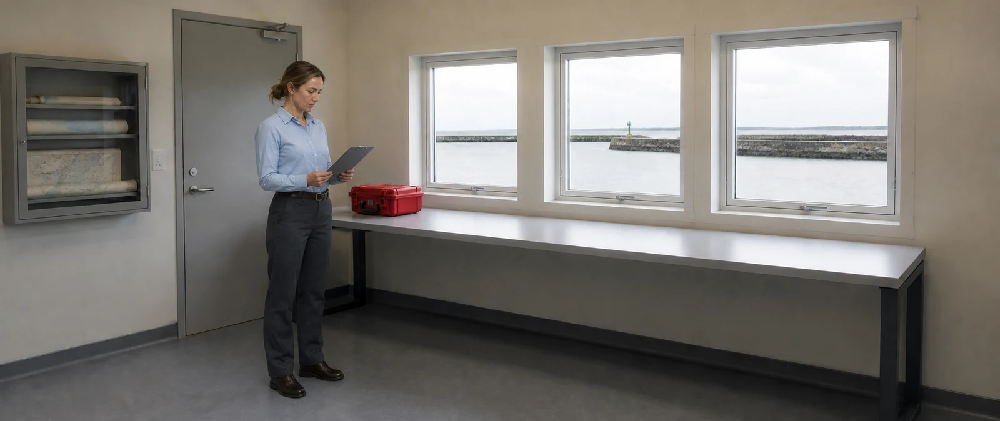

<div align="center">
  

  <p><strong>从真人剧本直接推进到洁净权威资产、空间一致的序列、可执行运镜和可人工上 Higgsfield 的便携制作包。</strong></p>

  <p>
    <a href="README.md">English</a> ·
    <a href="https://hughhhhcoder.github.io/cinematic-ai-director/zh-CN/">中文文档</a> ·
    <a href="https://github.com/Hughhhhcoder/cinematic-ai-director/releases/latest">最新版本</a>
  </p>
</div>



## 项目定位

很多 AI 影视流程只优化“一张好看的图”。真正制作需要更难的东西：同一人物保持准确身份和身材，同一地点能从真实可达机位反复拍摄，状态只在剧情发生变化时改变，天气与光线产生物理后果，最终提示与底层制作事实完全一致。

`cinematic-ai-director` 是面向真人电影、广告和 MV 的 Codex Skill 与零运行依赖 Python 工具。它把生成变成一条可审计生产链：

- 后台允许出现失败候选，但失败图绝不会进入权威清单、用户审批或导出；
- 身份、角色身材、地点拓扑、道具、环境、摄影和时间分别管理；
- 用户常规只需批准一次 Foundation 和每个序列一次；
- 最终交付便携的离线 Higgsfield 制作包，Skill 不登录平台、不上传、不消费积分。

> 本项目是独立开源项目，与 Higgsfield、OpenAI 不存在隶属或官方背书关系。

## v1.6 核心能力

| 系统 | 生产标准 |
|---|---|
| 真人实拍质量 | 正向摄影证据、来源型皮肤高光、材质独立粗糙度、四尺度涂抹/CG/脏纹检查 |
| 选角与身材 | 按角色推导体态、可测目标、服装轮廓与淘汰条件，不回退模型默认差比例 |
| 身份几何 | 每人一张 4×2 白底统一身份检查板、一次共享身份解算、七张确定性裁图、人物专属比例/骨架锁和多人投影 QA |
| 世界连续性 | 地点世界/状态、制作设计 DNA、道具制造结构与状态、返回旧地点复用 |
| 人物入景证明 | 在任何风格化人物叙事帧之前，必须以批准空场景为不可变底片，证明人物共享曝光、光场、焦点、有限动态范围且场景结构不漂移 |
| 空间执行 | 建立图、侧面四分之三图、唯一主锚点、固定坐标、机位/人物标记与画外距离 |
| 自适应摄影 | 剧本推导 Treatment、摄影观察者、画幅门、合理光源、有限场景参照动态范围、曝光/焦点和精致上限 |
| 环境物理 | 雨雪雾烟、尘风、火光、水下与热浪的材料、曝光、声音和时间后果 |
| 运镜与时间 | 可重建路径、净空/视差、拍摄/交付帧率、快门曝光、速度映射和方向型动态模糊 |
| 低打扰审批 | 独立候选、隐藏失败、Foundation/序列原子审批和依赖范围返工 |
| Higgsfield 交付 | 严格绑定带日期的 Cinema Studio 4 + Seedance 2.5 官方 Profile、官方提示顺序、确定性 `@handle` 与离线验证 |

## 完整流程



权威链是硬约束：失败或未批准根不能偷偷进入分镜，上一序列桥接帧也不能取代人物和地点根。

## 实拍质量而不是空泛“电影感”

生图策略默认不使用 `8K`、`pores`、`gritty`、`film grain`、`hero lighting`、`dramatic rim light`、`premium cinematic` 等捷径。它们很容易让皮肤、衣料、墙面、金属和玻璃共享同一种 AI 亮脏纹理。

提示由结构化事实编译为六段：摄影事件、批准身份/世界/状态、真实机位与阻挡、来源光与材质响应、焦点曝光与现场妥协、最多四组紧凑排除。每张入选图片都要在缩略图、适配窗口、100% 和 200% 通过，并记录“为什么它像真实摄影”的正向证据。

真实设备的动态范围永远有限。每张生成照片和每个 Ready 镜头必须声明工作宽容度、场景反差估计、中间调锚点、曝光优先级、亮部行为、暗部底线，以及允许的 clipping 或阴影信息损失。若场景反差超过工作宽容度，亮暗至少一端必须真实丢失信息；禁止通过局部 tone mapping 或多曝光 HDR 合成把所有亮暗都摊平成同样清晰。

## 身份、人体比例与好身材

每个持续人物只有一个第一身份权威：一次 ImageGen 调用生成一张纯白背景 `4×2` 统一身份检查板，让所有角度共享同一次身份解算。上排固定为全身正面、全身左侧、全身右侧、全身背面；下排固定为脸部正面、脸部左侧、脸部右侧、留白。

必须先验收整张检查板。任何一格出现身份、解剖、比例、皮肤、头发、衣着、光线、涂抹、CG 或重复底纹问题，就立即阻断该人物，不允许污染下游。通过后才无缩放、无重绘地确定性裁出七张 PNG，供检查和界面上传。裁图器记录靠近画布中心的明确白色横向分隔带，不强行假设上下排数学等高，避免 ImageGen 轻微移动分隔带时切掉鞋；分隔带缺失、歧义、有人体跨越或裁掉头发/鞋履都会明确失败。裁图永远不能替代统一板的权威地位。全身正背面建立人物自身的归一化比例签名，左右侧面验证体积和脸部拓扑。

`role_physique_brief` 根据年龄、职业、训练史、健康、年代、叙事作用、服装轮廓和明确选角意图推导普通可信、修长、健美、肌肉、模特、舞者、力量、耐力等体态。所谓“好比例”必须变成可测范围与轮廓要求；广角拉腿、塌腰、骨盆错误、肩腰胯丢失、衣服吞掉批准身材都直接失败。

虚构成年主角默认采用自然 4:6 腿身视觉关系；时尚、舞者、动作或表演角色可在有理由时采用 3:7 印象。无剧情理由的五五分会在身份根图、服装状态图和叙事帧三层被拦截。所有比例都用水平机位和正常透视确认，禁止靠低机位、广角、小头或拉长小腿伪造。

两人及以上同框时，系统保留每张统一检查板批准的身高和人体几何，再通过同一摄影机投影检查。必须记录机位高度/俯仰、人物标记与镜头距离、预期/观察投影高度关系、裁切身体地标、地平线/消失线、遮挡顺序，以及共同地面或明确高差。单独缩放某个人、局部透视不一致、脚底漂浮，或用裁切、浅景深和动态模糊掩盖错误，全部硬失败。

## 多场景和空间一致性

每个场景状态至少需要无人建立图和独立侧面四分之三广角，并共享一个固定主参照物作为 `(0,0,0)`。Ready 镜头必须保存空间图、可达机位、每个人物起点/朝向、到锚点距离、前中后景顺序、锚点在画内或画外的固定方向/距离以及动作起止标记；只写“画面左边”不能通过。

## 特殊环境、画幅、运镜和动态模糊

影视参考会被翻译为原创可观察行为，而不是把导演或片名发给模型。默认 16:9；1.33、1.37、1.66、1.85、2.00、2.39、9:16 必须有剧情理由，黑边不能烧进图片。

雨雪雾烟、尘风、闪电、火光、投影、水下和热浪必须改变能见度、积累、人物、材质、曝光、反射、焦点、声音和时间连续。动态模糊由帧率、快门、摄影机路径和人物速度推导，记录来源、方向、范围、强度、稳定参照与遮挡边缘，并阻断双影、幽灵肢体、果冻形变、纹理爬动和油光闪烁。

动态范围也按物理摄影规划。系统不会要求“亮部暗部全部最大细节”，而会选择曝光真正保护的对象——例如肤色、实景灯或剧情物件——并记录哪些光源核心可以接近过曝、哪些深暗区域可以沉到纹理底线。导出包把完整事实写入 `dynamic-range.json`，模型提示则只压缩进 Higgsfield 官方 `LIGHTING` 段，不新增伪官方标题。

## 安装

```bash
git clone https://github.com/Hughhhhcoder/cinematic-ai-director.git
cd cinematic-ai-director
python3 scripts/install_skill.py install
```

已有安装不会被静默覆盖：

```bash
python3 scripts/install_skill.py install --replace
python3 scripts/install_skill.py verify
```

`--replace` 会先做时间戳备份，失败自动回滚。运行时仅需要 Python 3.10+ 标准库。

## 快速开始与命令

```bash
python3 scripts/film_project.py init --title "Night Shift" --slug night-shift --root ./ai-film
python3 scripts/film_project.py validate ./ai-film/night-shift
```

然后在 Codex 中使用 `$cinematic-ai-director` 提供真人剧本。公开命令包括：`init`、`validate`、`build-reference-board`、`compile-prompts`、`build-review-board`、`record-review` 和 `export-higgsfield`。

完整说明见[中文文档站](https://hughhhhcoder.github.io/cinematic-ai-director/zh-CN/)和经过验证的 [`examples/night-shift`](examples/night-shift/) 示例。

## Higgsfield 边界

导出包包含上传顺序、参考职责、`@handle`、状态锁、空间图、质量 Profile、画幅、摄影路径、环境、时间锁、逐镜设置、提示、运行说明、校验和和离线验证器。v1.6 成功导出即表示严格符合带日期的官方 Profile `cinema-studio-4-seedance-2.5-official-2026-08-27`：Cinema Studio 4 + Seedance 2.5、官方提示顺序 `GLOBAL STYLE → SCENE → CHARACTERS → LOCATION → FIRST FRAME AND BLOCKING → Shot n → OPTICS → CAMERA → PHYSICS → LIGHTING → AUDIO`、明确参考职责、编号 Shot 与 `Hard cut`、最长 30 秒、最高原生 1080p、最多 50 个参考、9:16–21:9 和原生音频。当前界面若与快照不一致，必须先更新适配器和测试，禁止静默降级。

它不会安装插件、登录、上传、调用生成接口或消费积分，也不会虚构第三方随机模型的像素必然成功。能够百分百保证的是带版本的材料包结构、提示顺序、引用职责和阻断合同。官方依据：[Seedance 2.5 提示指南](https://higgsfield.ai/blog/seedance-2-5-prompting-guide)、[短片参考流程](https://higgsfield.ai/blog/ai-short-film-youtube-guide)、[真实动作流程](https://higgsfield.ai/blog/realistic-ai-human-movement)、[Cinema Studio 4](https://higgsfield.ai/blog/cinema-studio-4-0)。

## 效果展示

v1.6.5 公开画廊只保留一条洁净证据链，全部使用 Codex 内置 ImageGen：单次统一身份检查板 → 尺度明确的无人物空间权威图 → 锁定地点的人物插入探针。探针故意不使用特殊天气、英雄光、胶片模拟或戏剧化调色。批准空场景必须是第一引用和不可变编辑底片，身份板作为第二引用只提供人物身份。三个候选分别编辑同一底片；人物必须共享曝光、来源光、焦点、接地与有限动态范围，并且桌台尺寸/前缘/支撑、窗、门、柜体、红色锚点、机位和裁切在人物编辑框之外保持对应，才能公开。

| 单次共享身份解算检查板 | 无人物空场景 | 同人物进入同场景 |
|---|---|---|
|  |  |  |

这是刻意精简的发布证明，不虚构统计通过率。保留提示、生成来源 ID、原图与 WebP 的 SHA-256、统一板七张确定性裁图、编辑底片优先的参考顺序、三候选选片记录、归一化场景地标、编辑框外像素统计、四尺度 QA、有限动态范围与人物—环境融合审查均记录在 [`showcase/evidence.json`](showcase/evidence.json) 与[画廊文档](https://hughhhhcoder.github.io/cinematic-ai-director/gallery/)。失败候选已从公开文件树移除。

## 可复现性和限制

- `pixel_reproducible` 永远是 `false`；内置 ImageGen 不提供稳定种子和不可变公开模型快照。
- 可复现的是 Schema、制作事实、提示编译、引用顺序、哈希、候选隔离、审批、验证、评审板排版和导出。
- 跨次身份与构图仍可能失败；“稳定”表示失败图被阻断，不表示每次第一次原始生成都成功。
- 视觉 QA 是明确的 Codex/人工审查记录，不虚构自动审美评分。
- v1.0–v1.5 只报告 `LEGACY_SCHEMA`，不会自动迁移。

## 贡献、许可与安全

请阅读[贡献指南](CONTRIBUTING.zh-CN.md)、[行为准则](CODE_OF_CONDUCT.md)和[安全策略](SECURITY.md)。项目采用 Apache-2.0，Copyright 2026 Hughhhhcoder。第三方来源见 [THIRD_PARTY_NOTICES.md](THIRD_PARTY_NOTICES.md)。
