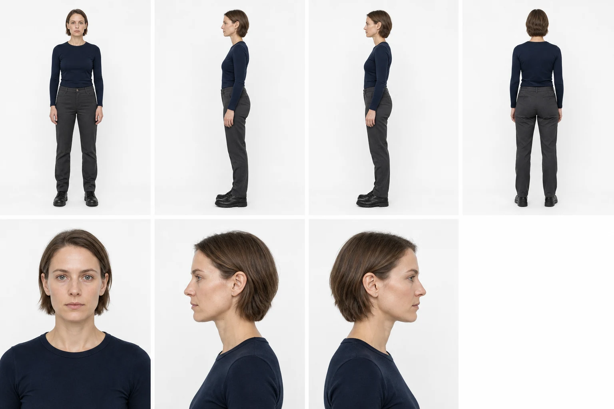
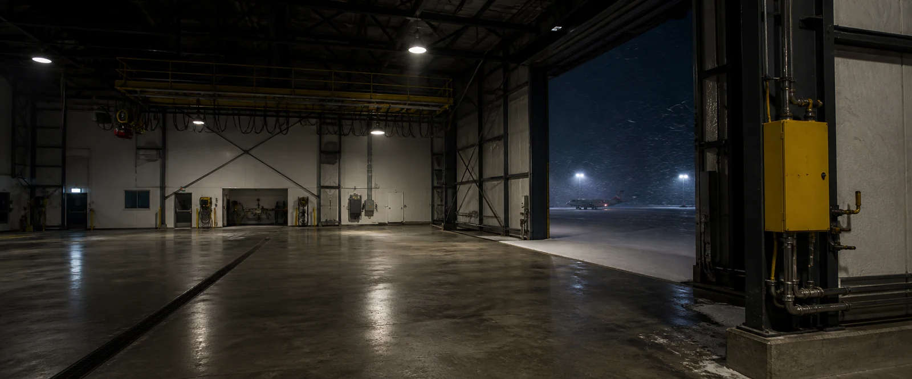
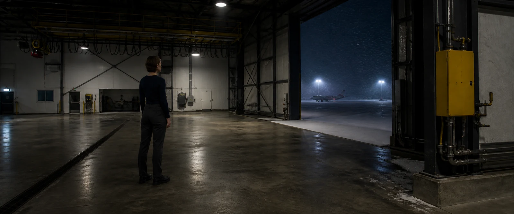

# Compact v1.6.1 evidence gallery

This release intentionally shows only three approved artifacts: one complete identity authority, one native 2.39:1 empty location, and one native 2.39:1 live-action narrative frame that combines them. All people are fictional adults and the location is original. No image contains baked black bars. The gallery excludes the user's calibration photograph, earlier benchmarks, failed candidates, and third-party project media.

The WebP files below are publication derivatives only. The retained PNGs remain the visual evidence; exact prompts, source-generation IDs, SHA-256 values, deterministic crop records, QA observations, and finite-dynamic-range reviews live in [`showcase/evidence.json`](https://github.com/Hughhhhcoder/cinematic-ai-director/blob/main/showcase/evidence.json).

  
<strong>01 · One shared identity solve</strong> One ImageGen call creates the full Inspector. The whole board passes first; seven upload/check views are then cropped from the recorded white row gutter without resampling or redraw. Her role-matched long-legged silhouette is established by the neutral body views rather than a low camera or lens stretch.

  
<strong>02 · Theatrical empty spatial authority</strong> A reachable side-door camera, buildable portal frame, service bays, drains, distinct clean materials, a yellow fixed anchor, and layered 2.39:1 depth. Apron-light cores clip and the roof void falls to black instead of being flattened by pseudo-HDR.

  
<strong>03 · Person in the approved world</strong> The Inspector remains first identity authority and the hangar remains world authority. This scale-and-decision shot deliberately keeps the face non-readable instead of pretending a distant face can also prove skin. The grounded stance, long-legged balance, yellow anchor, clipped practical peaks and real shadow loss survive the narrative frame.

## What was checked

Each retained original was inspected at thumbnail, fit, 100%, and 200% scales for live-action photographic evidence, geometry where applicable, source-light causality, oily or plastic skin, painterly smear, repeated AI texture, cross-material contamination, sharpening halos, and animation/CG/PBR appearance.

Dynamic range is also evaluated as a finite capture decision. The release records a working latitude, estimated scene contrast, exposure priority, middle-tone anchor, highlight transition, shadow floor, and allowed loss. This does **not** claim a real camera, EXIF, measured sensor latitude, or pixel reproducibility. It demonstrates the v1.6 rule that every photographed asset must decide what exposure protects; local tone mapping or exposure fusion may not make every tonal region equally explicit.

## Identity authority

The Inspector is the first and only identity input. Its fixed cells are:

`full_front · full_left_profile · full_right_profile · full_back`  
`portrait_front · portrait_left_profile · portrait_right_profile · blank`

`showcase/originals/identity-crops/identity-white-arctic-survey-pilot-v003/crop-map.json` records the detected central white gutter, exact crop coordinates and output hashes. Those seven PNGs are convenience files, never independent identity generations and never a replacement for the unified board. An ambiguous gutter, anatomy crossing it, or any crop that cuts hair or footwear is a hard failure.

## Honest evidence boundary

This compact gallery is not a multi-run benchmark and makes no statistical pass-rate claim. Built-in ImageGen has no stable public seed, so `pixel_reproducible` is `false`. What the repository reproduces is the workflow, prompt, reference order, exact retained files, hashes, crop operation, QA contract, approval gates, and export behavior.
