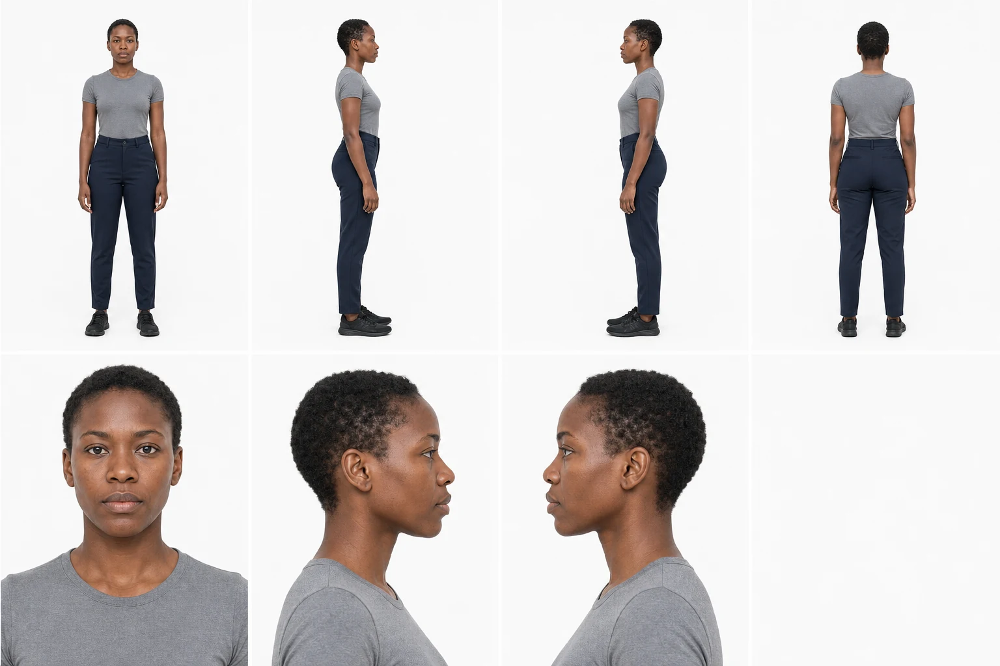
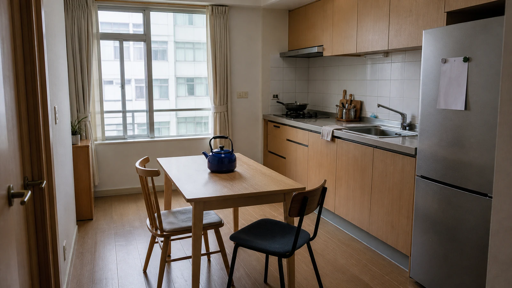
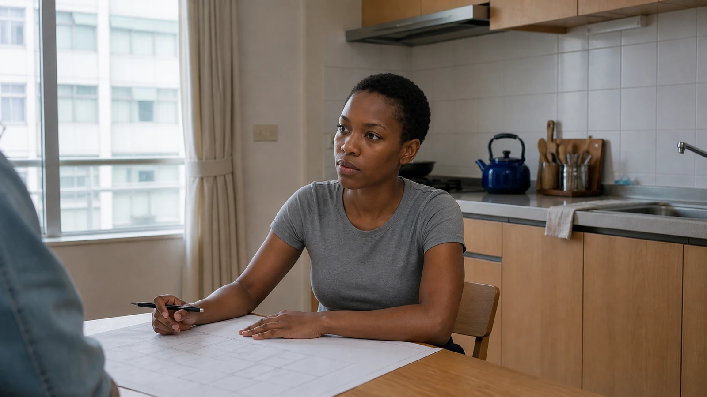

# Compact v1.6 evidence gallery

This release intentionally shows only three approved artifacts: one complete identity authority, one empty location, and one live-action narrative frame that combines them. All people are fictional adults and the location is original. The gallery excludes the user's calibration photograph, earlier benchmarks, failed candidates, and third-party project media.

The WebP files below are publication derivatives only. The retained PNGs remain the visual evidence; exact prompts, source-generation IDs, SHA-256 values, deterministic crop records, QA observations, and finite-dynamic-range reviews live in [`showcase/evidence.json`](https://github.com/Hughhhhcoder/cinematic-ai-director/blob/main/showcase/evidence.json).

  
<strong>01 · One shared identity solve</strong> One ImageGen call creates the full Inspector. The whole board passes first; seven upload/check views are then cropped exactly without resampling or redraw.

  
<strong>02 · Empty spatial authority</strong> Reachable camera, adjacent planes, ordinary construction, distinct clean materials, and a fixed cobalt-kettle anchor.

  
<strong>03 · Person in the approved world</strong> The Inspector remains first identity authority; the kitchen remains world authority. Matte source-led skin, task-led performance, coherent scale, and the same spatial anchor survive the narrative frame.

## What was checked

Each retained original was inspected at thumbnail, fit, 100%, and 200% scales for live-action photographic evidence, geometry where applicable, source-light causality, oily or plastic skin, painterly smear, repeated AI texture, cross-material contamination, sharpening halos, and animation/CG/PBR appearance.

Dynamic range is also evaluated as a finite capture decision. The release records a working latitude, estimated scene contrast, exposure priority, middle-tone anchor, highlight transition, shadow floor, and allowed loss. This does **not** claim a real camera, EXIF, measured sensor latitude, or pixel reproducibility. It demonstrates the v1.6 rule that every photographed asset must decide what exposure protects; local tone mapping or exposure fusion may not make every tonal region equally explicit.

## Identity authority

The Inspector is the first and only identity input. Its fixed cells are:

`full_front · full_left_profile · full_right_profile · full_back`  
`portrait_front · portrait_left_profile · portrait_right_profile · blank`

`showcase/originals/identity-crops/identity-black-woman-v001/crop-map.json` records the exact cell coordinates and output hashes. Those seven PNGs are convenience files, never independent identity generations and never a replacement for the unified board.

## Honest evidence boundary

This compact gallery is not a multi-run benchmark and makes no statistical pass-rate claim. Built-in ImageGen has no stable public seed, so `pixel_reproducible` is `false`. What the repository reproduces is the workflow, prompt, reference order, exact retained files, hashes, crop operation, QA contract, approval gates, and export behavior.
