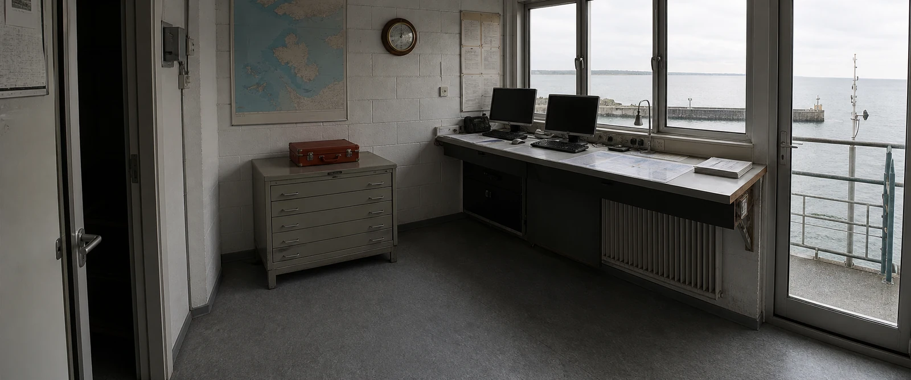
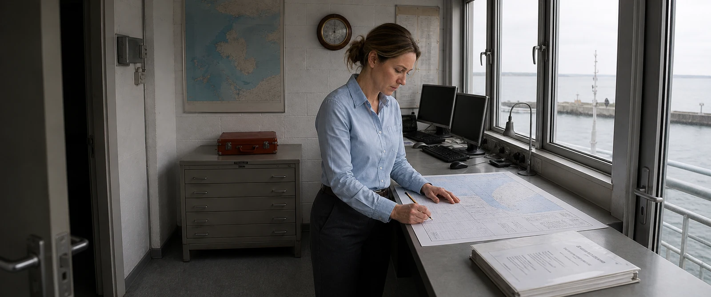

# Single-chain v1.6.4 live-action proof

This release publishes exactly three approved artifacts from one new evidence chain: unified identity authority → empty world authority → ordinary-light person/world integration probe. The fictional subject is an adult coastal survey engineer; the tide-monitoring station is an original location. The scene and probe are native 2.39:1 captures with no baked black bars.

The probe is intentionally plain. Special weather, hero lighting, film emulation, dramatic grading and “cinematic” adjectives are disabled until a person can inhabit the approved world under ordinary overcast light. Three candidates were generated independently from the same two roots. Only the one that passed all hard gates is public; the other candidates cannot become references, assets or release files.

The WebP files below are publication derivatives only. The retained PNGs remain the evidence. Exact prompts, source-generation IDs, SHA-256 values, deterministic crop records, candidate selection, reference order, finite-dynamic-range decisions and four-scale QA live in [`showcase/evidence.json`](https://github.com/Hughhhhcoder/cinematic-ai-director/blob/main/showcase/evidence.json). Every superseded Arctic and Western image, failed candidate, private calibration photograph and third-party project medium is absent from the release tree.

  
<strong>01 · Unified identity authority</strong> One ImageGen call creates the complete 4×2 white Inspector. The board—not an oily face seed—is the first identity input. It establishes one asymmetric face, one natural-dry skin response, one practical survey wardrobe and a balanced role-appropriate 4:6 body. Seven convenience views are cropped deterministically only after the whole board passes.

  
<strong>02 · Empty world authority</strong> A reachable side-three-quarter camera records one coherent tide station, access deck, railings, equipment shelter, sea wall and fixed red calibration-case anchor. Overcast sky and water are bright while shelter recesses lose information; finite capture latitude does not flatten every tonal region into pseudo-HDR.

  
<strong>03 · Person–world integration probe</strong> The Inspector is reference 1 and the location is reference 2. One physical camera and exposure system govern skin, coat, steel, concrete, sky and water. The subject shares source direction, focus falloff, occlusion, contact geometry and shadow softness with the world; there is no oil film, waxy face, cut-out edge, separate tone mapping, game rendering or repeated AI texture.

## What the new hard gate proves

Passing a character board and a location separately is insufficient. Before Look Tests, special environments, multi-person coverage, Photoboards, keyframes, Ready shots or Higgsfield export, the Skill now requires an approved `live_action_probe` made from exactly those two authority roots in fixed order.

The probe is checked at thumbnail, fit, 100% and 200% for:

- one camera projection, horizon, focus system and exposure decision;
- source-shaped skin highlights without uniform oil film, isolated bright patches, wax or plastic;
- shared light direction, shadow softness and color contamination;
- believable foot/hand contact, scale, occlusion and edge behavior;
- distinct skin, hair, textile, painted metal, concrete, glass and water responses;
- finite highlight clipping and shadow loss instead of local tone-mapped pseudo-HDR;
- no painterly smear, repeated cellular/swirl texture, animation, CG/PBR or game-cinematic appearance.

The first batch contains three independent candidates. If all fail, the second and final batch changes one named variable and generates two new independent candidates. A second failure marks the backend `backend_realism_blocked`; style, weather and downstream metadata cannot overrule visible synthetic pixels.

## Identity authority

The Inspector's fixed cells are:

`full_front · full_left_profile · full_right_profile · full_back`  
`portrait_front · portrait_left_profile · portrait_right_profile · blank`

The matching directory under `showcase/originals/identity-crops/` records the detected white row gutter, exact crop coordinates and output hashes. Crops are convenience/upload files, never separate generations and never replacements for the unified board. An ambiguous gutter, anatomy crossing it, identity drift, truncated hair or footwear, oily skin, poor body balance or synthetic texture fails the whole person before any dependent image is generated.

## Honest evidence boundary

This compact gallery is not a statistical benchmark. Built-in ImageGen has no stable public seed, so `pixel_reproducible` is `false`. What is reproducible is the workflow, retained prompts and files, authority order, hashes, deterministic crops, candidate isolation, QA contract, approval gates and export blockers. A stochastic regeneration is not promised to reproduce these pixels; a failed regeneration is promised not to enter the production package.
