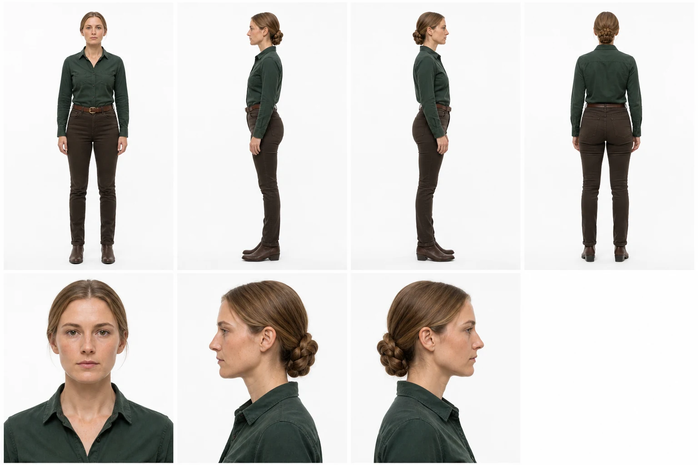
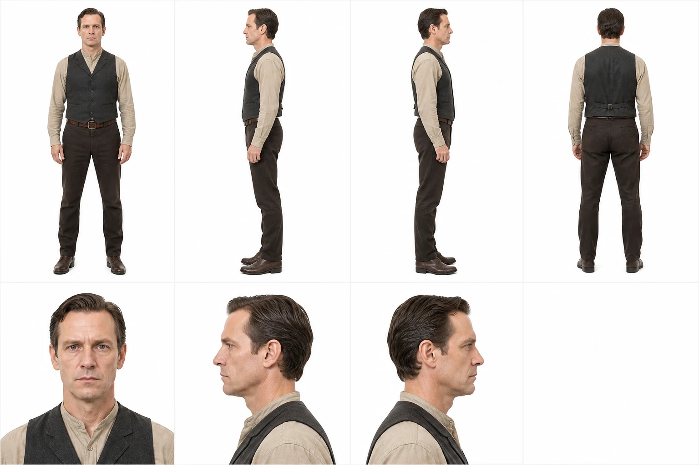
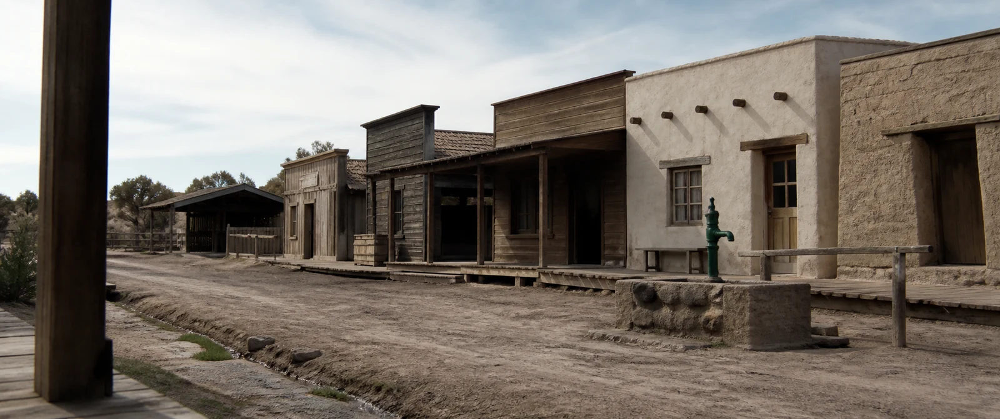
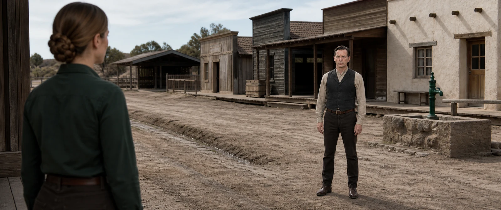

# Compact v1.6.2 evidence gallery

This release retains seven approved artifacts: three complete identity authorities, two native 2.39:1 empty locations, and two native 2.39:1 live-action narrative frames. The Western chain adds a two-person projection test built from two separate shared-solve Inspectors and one approved location. All people are fictional adults and every location is original. No image contains baked black bars.

The WebP files below are publication derivatives only. The retained PNGs remain the evidence; exact prompts, source-generation IDs, SHA-256 values, deterministic crop records, QA observations, reference order, finite-dynamic-range reviews, and the Western multi-person projection record live in [`showcase/evidence.json`](https://github.com/Hughhhhcoder/cinematic-ai-director/blob/main/showcase/evidence.json). The user's calibration photograph, earlier benchmarks, failed candidates, and third-party project media are excluded.

  
<strong>01 · Arctic lead identity authority</strong> One ImageGen call creates the full Inspector. The whole board passes first; seven upload/check views are then cropped from the recorded white row gutter without resampling or redraw. Her role-matched long-legged silhouette is established by neutral body views rather than lens stretch.

  
<strong>02 · Arctic spatial authority</strong> A reachable side-door camera, buildable portal frame, service bays, drains, separate materials, and a fixed yellow anchor establish reconstructable space. Practical cores clip while the roof void falls to black instead of pseudo-HDR flattening.

  
<strong>03 · Arctic person in world</strong> The Inspector remains identity authority and the hangar remains world authority. A grounded rear-three-quarter stance carries scale and weather; the frame does not pretend a distant unreadable face can also prove skin quality.

  
<strong>04 · Western woman identity authority</strong> One solve preserves face, braid, wardrobe and an approved long-legged athletic skeleton. Natural-dry skin, hair, cotton, wool and leather keep separate responses without a cosmetic highlight layer.

  
<strong>05 · Western man identity authority</strong> One solve preserves face, hair, wardrobe and a balanced athletic skeleton. The body is established through level, normal-perspective full views rather than a tiny head, low camera or stretched legs.

  
<strong>06 · Observational Western location</strong> An ordinary reachable porch-edge position, near-post obstruction, six irregular practical buildings and one fixed green pump replace an effects-driven Western poster. Pale sky may lose information while deep porch and livery interiors remain genuinely dark.

  
<strong>07 · Two-person projection proof</strong> The two Inspectors remain first references and the street remains world authority. One reachable camera projection governs both bodies: the cropped near woman, complete distant man, green anchor, ground elevation, horizon, occlusion and focus falloff are checked together. No person is separately scaled for composition.

## What was checked

Each retained original was inspected at thumbnail, fit, 100%, and 200% scales for live-action photographic evidence, geometry where applicable, source-light causality, oily or plastic skin, painterly smear, repeated AI texture, cross-material contamination, sharpening halos, and animation/CG/PBR appearance.

Dynamic range is evaluated as a finite capture decision. Every record declares a working latitude, estimated scene contrast, exposure priority, middle-tone anchor, highlight transition, shadow floor, and allowed loss. This does **not** claim a real camera, EXIF, measured sensor latitude, or pixel reproducibility. It demonstrates the rule that every photographed asset must decide what exposure protects; local tone mapping or exposure fusion may not make every tonal region equally explicit.

The Western confrontation also records a multi-person projection contract. Each person inherits an approved standing height and body geometry from their own Inspector. One camera height, pitch and rectilinear projection govern both distances. The foreground woman is intentionally cropped, so the record does not invent an observed full-frame height; it uses visible head–shoulder–waist landmarks, the complete distant man, connected ground surfaces with an elevation offset, horizon/vanishing lines, and occlusion order. `per_person_scale_transform` must remain `false`.

## Identity authority

Every Inspector is the first and only identity input. Its fixed cells are:

`full_front · full_left_profile · full_right_profile · full_back`  
`portrait_front · portrait_left_profile · portrait_right_profile · blank`

Each matching directory under `showcase/originals/identity-crops/` records the detected central white gutter, exact crop coordinates, and output hashes. Those seven PNGs are convenience files, never independent identity generations and never a replacement for the unified board. An ambiguous gutter, anatomy crossing it, or any crop that cuts hair or footwear is a hard failure.

## Honest evidence boundary

This compact gallery is not a multi-run benchmark and makes no statistical pass-rate claim. Built-in ImageGen has no stable public seed, so `pixel_reproducible` is `false`. Reproducible evidence includes the workflow, exact retained prompts and files, reference order, hashes, crop operation, QA contract, approval gates, and export behavior. A stochastic regeneration is not promised to reproduce these pixels.
