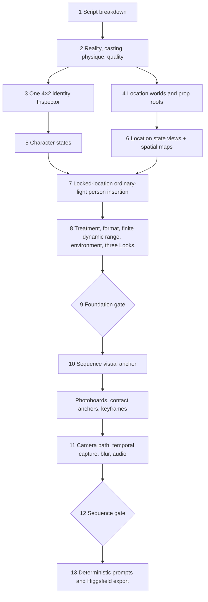

# Complete production workflow

## 1. Script breakdown

Record scene task, world/state IDs, time, weather or atmosphere, special-light events, every persistent character/wardrobe/injury/body change, prop state and position, movement start/end, physical contacts, dialogue, sound, and when each fact stops being true.

## 2. Reality and casting

The reality brief explains why people, places, objects, wear, camera access, and polish level belong to the story. Production-design DNA fixes period, economics, building and infrastructure logic, material/label rules, color sources, and bounded aging.

The role-physique brief converts casting intent into silhouette, measurable normalized ranges, posture/gait, wardrobe behavior, must-have traits, and candidate rejection criteria.

## 3. Identity authorities

Generate one pure-white `4×2` Inspector in a single call so all angles share one identity solve. Validate the entire sheet before any crop or state exists. If any cell fails identity, geometry, role physique, skin/material, lighting, or clean live-action QA, stop that person. After approval, crop seven exact views deterministically without resampling; these are inspection/UI aids, while the Inspector remains ground truth.

## 4–6. State, world, and space

States always derive directly from approved roots—never from the previous state. Each location state includes an establishing wide and a side-three-quarter wide with one shared, approved, stationary primary anchor. The spatial map binds that anchor to `(0,0,0)`, named set axes, approximate dimensions, doors/windows, camera and subject marks, and movement paths.

## 7. Live-action integration proof

Before styling, use the approved empty location as an immutable edit plate and insert the unified-Inspector subject in a bounded region under ordinary light. It must show a readable face, a simple task/contact, shared light/focus/occlusion and finite exposure without oil film, synthetic game surfaces, cut-out edges or separate subject tone mapping. At least six location landmarks and outside-edit-region pixel correspondence must also prove that furniture, architecture, fixtures, camera and crop did not drift. Two failed batches block all downstream person-bearing generation.

## 8–9. Look and Foundation

Approve a format and finite project dynamic-range contract before Look generation. Three independent photography hypotheses keep story facts constant but differ materially in at least three areas such as witness position, optics, movement, light, atmosphere, temporal sampling, or reframing. Each asset and Look declares its own exposure priority, middle-tone anchor, highlight/shadow behavior, and allowed loss. Each Look first survives its own backstage candidate pool and hard QA; the user then sees a blind comparison alongside identity, locations, anchor, quality profile, and format.

## 10–12. Sequence production

Adjacent shots share a sequence only when character, location, prop, environment, light, capture profile, format, and temporal signatures are identical. Every sequence has one joint visual anchor and a fixed reference-stack hash. Photoboards, keyframes, pose/contact anchors, camera paths, temporal capture, blur, physical interaction, and audio inherit that exact state.

The user reviews one combined sequence board. A change request invalidates only the affected asset and direct dependents.

## 13. Delivery

The compiler converts structured facts into the official Seedance 2.5 prompt order. Dynamic-range facts are compressed into official `LIGHTING`, while full plans remain in `dynamic-range.json`; no non-official model heading is added. The strict v1.6 exporter binds Cinema Studio 4 + Seedance 2.5 under the dated `2026-08-27` profile and packages reference roles/order, state/quality/space/format/path/environment/time facts, settings, runbooks, official conformance evidence, and checksums. A Profile mismatch, unsupported control, more than 50 references, a shot over 30 seconds, or an aspect outside 9:16–21:9 blocks export instead of being silently approximated.
