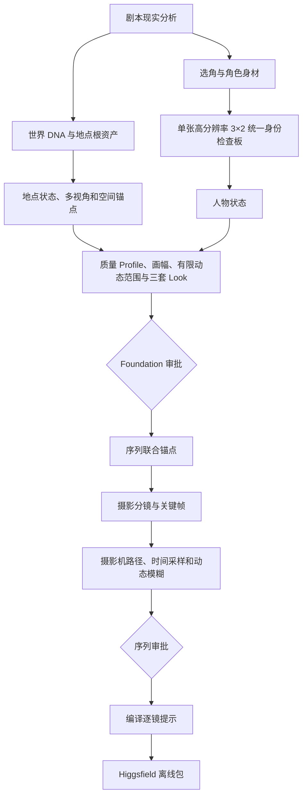

# 完整流程

## 1. 现实简报

先回答“为什么这台摄影机在这里”：人物为何可信、地点如何被使用、布景痕迹如何产生、允许多精致、哪些美化会破坏题材。摄影主张必须由剧本推导，而不是套用统一青橙、逆光、浅景深或颗粒。

## 2. 身份与身材

每个持续人物先形成 `role_physique_brief`，把职业、训练史、生活条件和叙事功能翻译为体型、肌肉分布、姿态、比例与服装轮廓。随后只调用一次 ImageGen，生成大尺寸 3×2 纯白底身份检查板：上排全身正面、一个符合角色/剧情的真实侧面、全身背面；下排大尺寸脸部正面、左侧、右侧。六个角度共享同一次身份与身体解算。必须先验收整板及主体原生像素覆盖；任一格出现身份、几何、身材、油膜、涂抹、CG、地形线/迷宫式底纹、失焦或细节不足，就停止该人物。通过后才无缩放、无重绘裁出六张检查/UI 文件，统一板始终是唯一第一身份权威。旧 4×2 七图仅作为已有 v1.6 项目的兼容适配器。

虚构成年主角默认按自然 4:6 腿身视觉比例设计；时尚、舞者、动作和表演角色可有理由地采用 3:7 印象。无剧情理由的五五分直接失败，并且不得用低机位或广角假拉腿。

两人及以上同框时，每个人必须继承各自统一检查板中的批准身高与人体几何。逐镜记录同一摄影机投影、机位高度/俯仰、人物场地标记和镜头距离、预期/观察投影比与容差、裁切身体地标、地平线/消失线、遮挡顺序，以及共同地面或明确高差。禁止为“构图平衡”单独缩放人物，也不能用浅景深、裁切或动态模糊掩盖比例、脚底接地和透视错误。

状态只记录相对根身份的允许增量。服装、伤势、湿润、年龄或软组织变化不得改写骨性比例和五官结构，也不得从前一个状态递归编辑。

## 3. 世界与空间

每个地点有不可变 `location_world`，每种昼夜、天气、布置或损坏是单独 `location_state`。一个场景状态至少需要无人建立图和侧面四分之三广角图，必要时扩展正面、左右斜角和反向广角。

每个状态只有一个固定主锚点。它定义场地坐标 `(0,0,0)`；门窗、人物、摄影机和移动路径都使用不随反打翻转的场地关系，同时保留自然语言地标说明。

## 4. 后台候选和审批

关键根、每套 Look、序列联合锚点与英雄关键帧各生成三张独立候选；普通角度和普通关键帧各生成两张。候选不能互相编辑，失败候选只留下哈希和匿名化原因，绝不进入权威清单或用户审批。

Codex 在缩略图、适配窗口、100% 和 200% 四种尺度检查人体、皮肤、毛发、织物、空间、光源、材质和常见 AI 纹理。第一批全失败时只允许一次单变量修正；第二批仍失败则标记 `model_blocked`。

## 5. 摄影、天气与时间

画幅和项目有限动态范围合同在 Look Test 前批准。摄影 Treatment 记录观察者身份、叙事距离、空间/光学行为、光源、曝光、焦点、承托惯性、颜色管线和精致上限。每张资产和每个镜头还要独立记录曝光保护对象、中间调锚点、高光/暗部行为及允许损失；禁止用局部 tone mapping 或多曝光 HDR 让所有亮暗同样清楚。

雨、雪、雾烟、尘沙、闪电、火光、水下与热浪必须改变能见度、地面、衣发、皮肤、材料、曝光、反射、焦点、声音和时间连续性。动态模糊由帧率、快门角、摄影机路径和主体速度推导，不能只写“cinematic motion blur”。

## 6. 序列与交付

同地点、灯光、服装、伤势和摄影 Profile 的连续镜头归入同一序列。每个序列保存联合锚点、固定引用顺序和 SHA-256。上一序列尾帧只能补充动作、构图和光线，不能代替原始人物和地点权威资产。

序列通过后，工具从清单事实编译提示并自动生成 Higgsfield 包；完整动态范围事实写入 `dynamic-range.json`，模型可见部分只进入官方 `LIGHTING` 段；内部 QA 不会被一股脑塞进模型提示。
